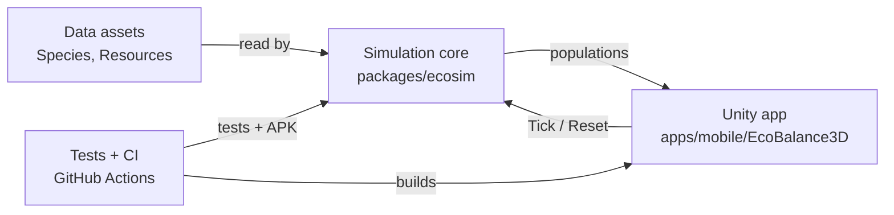
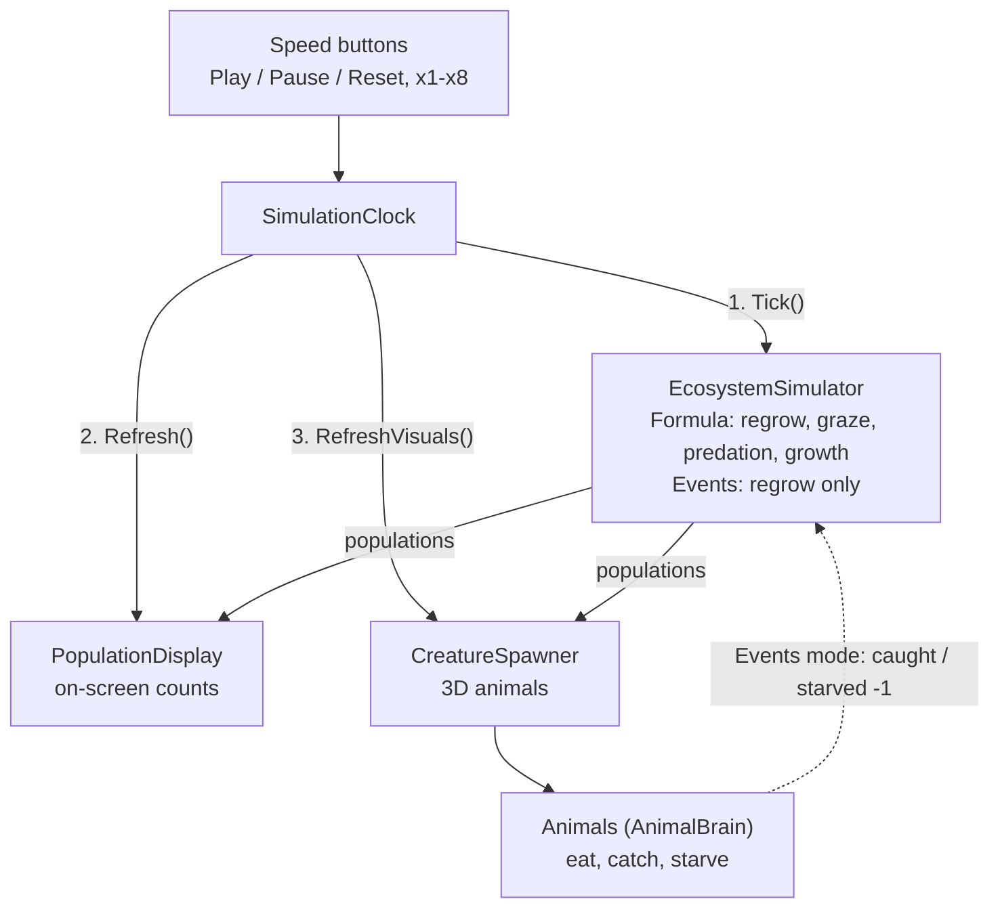
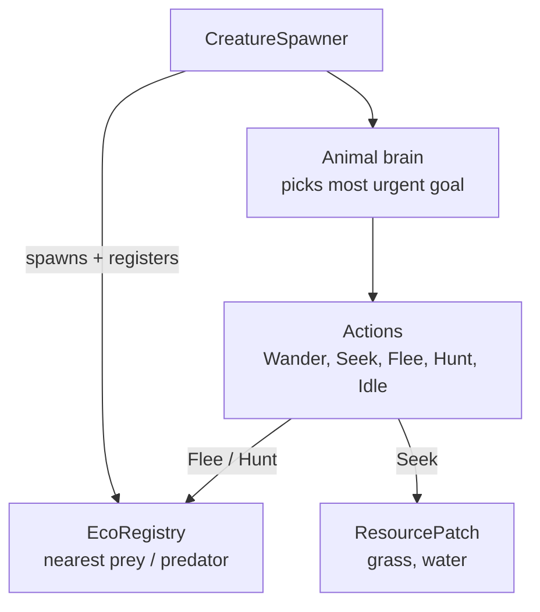

# EcoBalance — System Architecture (v0.1)

**Owner of this document:** Tan Wei Leong (Tech Lead)
**Status:** v0.1 for Milestone 1. It describes what is built and what is planned. Anything planned is marked *(planned)*.

See also: [toolchain.md](toolchain.md) (technology choices), [data-pipeline.md](data-pipeline.md) (asset/data rules) and [deliverables.md](deliverables.md) (M1/M2/M3 targets).

## 1. Tech stack (summary)

| | |
|---|---|
| Engine | Unity **6000.6.0f1** (Unity 6), URP |
| Language | C# |
| Target platform | Android tablet |
| Source control / CI | GitHub + GitHub Actions (GameCI): repo checks + EditMode tests (unit, scene smoke, performance) on every PR and on `main`; weekly / `v*` tag / manual Android build, APK stored on team Gitea ([CI details](infra/ci.md)) |
| Project management | Jira (SCRUM project) |

## 2. Architecture diagram

Split into three small diagrams so each stays readable on GitHub.

### 2.1 Overview — main blocks



The core never depends on the app (arrows into `packages/ecosim` are calls through its public API; see §7).

### 2.2 Simulation loop — every tick



The simulator has two modes (`EcosystemSimulator.mode`):

| Mode | How populations change | Used by |
|---|---|---|
| **Formula** (default) | Each `Tick()`: predation = rate × predators × prey; grazers share grass; well-fed species grow, underfed ones starve. Deterministic. | EditMode tests, balancing |
| **Events** | Only from what the 3D animals do: leopard catches sheep → sheep −1; no food for 15 s (sheep) / 20 s (leopard) → −1. Eating only feeds the animal: there is **no reproduction yet** (the `eatingAddsOffspring` switch, off by default, would add +1 per meal as a stand-in until the reproduction system exists). `Tick()` only regrows grass and water (+3). | SampleScene demo |

In both modes the numbers live in the simulator and `CreatureSpawner` keeps one model per animal; the animal that was caught or starved is the one removed.

### 2.3 Animal AI — one animal



Solid box `packages/ecosim` = reusable core; everything in `apps/mobile` depends on it, never the reverse (see §7).

**How the parts communicate**
- **App flow (F01):** `HomeScreen` → `MainMenu` loads `ConfigurationScreen`, which loads `SampleScene` additively behind the menu with time paused. The player sets starting numbers with `SpeciesCounter`; **Start** stores them in `EcosystemSimulator.StartingPopulationOverrides`, resets the ecosystem and resumes time.
- **Tick loop:** `SimulationClock.Update()` calls `EcosystemSimulator.Tick()`, then `PopulationDisplay.Refresh()` and `CreatureSpawner.RefreshVisuals()`. Play / Pause / Reset / speed (x1-x8) are on the clock, driven by `SimulationSpeedController` buttons. Reset calls `ResetEcosystem()` (starting populations).
- **Agents:** `CreatureSpawner` keeps the number of 3D animals in line with the population (one model per animal, rounded like the label) and registers each one in `EcoRegistry`. In SampleScene each animal runs `AnimalBrain`: flee > hunt > go to grass/water > wander, with a hunger timer; in Events mode it reports `RecordPredation` / `RecordEat` / `RecordStarvation` to the simulator. Each animal's `GoalOrientedAnimalBrain` scores its goals by need urgency and runs behaviour-tree actions: Seek finds the nearest `ResourcePatch`, Flee and Hunt ask `EcoRegistry` for the nearest predator / prey (from the Eats relationships).
- **Data in:** the simulator and AI read `SpeciesDefinition` / `ResourceDefinition` assets. Prey comes from `SpeciesDefinition.GetSpeciesTargets(RelationshipType.Eats)`.
- **Data out:** population counts live in `EcosystemSimulator.populations` (a dictionary keyed by species asset). The UI reads them directly for M1. From M2 the UI reads through `ISimulationDataProvider`, so it never depends on simulation internals.
- **Selection → inspection:** `ObjectSelector` publishes the selected object on the shared `SelectionContext` asset, and `InspectorPanel` listens to it and shows `IInspectable` stats.

## 3. Components and owners

Owners follow the M1 Technical Deliverable plan. *Primary* owners are listed first.

| Component | Key scripts / assets | Deliverable | Owner(s) | M1 status |
|---|---|---|---|---|
| Ecosystem Simulation Core | `packages/ecosim`: `EcosystemSimulator`, `EcoRegistry`; app: `SimulationClock` | T03 | Wei Leong, Reginald | Done: Formula + Events modes (eat / catch / starve), registry, Play/Pause/Reset/speed; tested |
| Relationship System | `Relationship`, `SpeciesDefinition.relationships` | T01 | Zhi Jie | Done (Eats / Needs / Affects), with tests |
| Entity Data System | `SpeciesDefinition`, `ResourceDefinition`, Need/Goal/ActionDefinition, species assets | T02 | Li Juan, Yusuf | Done: data-only species incl. needs/goals, audio, 3D model |
| Species authoring tool | `Editor/AnimalCreator` | T02 | Li Juan | Create + edit species from an Editor window |
| Simulation Data Display (UI) | `PopulationDisplay`, `UI/PopulationCounter`, `UI/ResourceLevels`, `UI/EventFeed`, `SimulationData/*` providers | T04 | Yan De, Dillon | Species and resource counts, resource levels and an event feed on screen, with tests; provider adapter planned M2 |
| Configuration flow | `UI/Configuration` (`MainMenu`, `ConfigurationScreen`, `SpeciesCounter`), HomeScreen + ConfigurationScreen scenes | F01 | Reginald, Shu Min | Set starting populations, then Start |
| Agent AI Controller | `GoalOrientedAnimalBrain` + behaviour tree (`Behaviourtreecore/*`), `ResourcePatch` | T07 | Yusuf, Zhi Jie, Reginald | Done: needs → goals; Wander, Seek grass, Flee, Hunt; goal-selection tests |
| Visualisation (population → agents) | `CreatureSpawner`, Blue Sheep and Snow Leopard 3D models | T03/T04 | Wei Leong, Li Juan | Agents spawn by population and register in `EcoRegistry` |
| Selection & Inspection | `Selection/*`, `Inspection/*`, `InspectorPanel` | F09 | Yan De | Tap-to-select + inspector panel framework |
| Audio | `Audio/AudioManager`, BGM + species SFX | — | Li Juan | Done: BGM/ambience, footsteps |
| Population history (M2) | `packages/ecosim/Runtime/History`: `PopulationHistory`, `PopulationHistoryRecorder` | T05 / F05 | Wei Leong | Done: per-day species and resource values, read by the graph and the case detector; tested |
| Investigation cases (M2, Free Exploration) | `packages/ecosim/Runtime/Cases`: `InvestigationCase`, `CaseEvaluator`, `CaseJournal`, `CaseDetector`; case assets in `Assets/_Project/Resources/Cases` | F07 / Field Journal | Wei Leong (engine), Dillon (UI), design (case content) | Engine done and tested; journal UI in progress |
| Balance model (M2) | `packages/ecosim/Runtime/Balance`: `BalanceModel`, `BalanceParameters` | T03 | Wei Leong | Headless agent model of design's simulation spec; proves cases are reachable; tested |
| Dev overlay (M2) | `Assets/_Project/Scripts/DevTools/SimDebugOverlay` | — | Wei Leong | Editor and development builds only: day, populations, case status |
| Metrics export (CSV) | *(planned, reads PopulationHistory)* | T05 (optional) | Li Juan | Not started |
| Weather & Hazard Events | *(planned)* | T06 (optional) | Unassigned | Not started |
| CI / build / test pipeline | `.github/workflows/unity-ci.yml`, `tools/ci/repo-checks.py`, `packages/ecosim/Tests/Editor/*`, `Assets/_Project/Tests/Editor/*` | #4, #5 | Wei Leong | Done: repo checks, unit + smoke + performance tests, weekly/tag/manual Android APK to Gitea ([details](infra/ci.md)) |
| UI/UX design | Figma / `docs/design/ui-ux` | — | Nomitha, Shu Min (Design) | Wireframes / mockups |

## 4. Data stores

| Store | What | Where |
|---|---|---|
| ScriptableObject assets | Species, resources, relationships, system configs | `Assets/_Project/ScriptableObjects/`, `Assets/_Project/Data/` |
| Runtime state | Populations and resource amounts (in memory, per play session) | `EcosystemSimulator.populations`, `ResourceDefinition.currentAmount` |
| Scenes / prefabs | Level layout and agent prefabs | `Assets/Scenes/`, `Assets/_Project/Prefabs/` |
| Population history | Per-day species and resource values (in memory, newest 1,000 days) | `PopulationHistoryRecorder.History` |
| Field Journal progress | Unlocked investigation case ids | Device `PlayerPrefs` (`EcoBalance.CaseJournal`) |
| Exported metrics *(planned, T05)* | Population history as CSV | — |

There is no server or database. EcoBalance is a single offline mobile app.

## 5. External systems

| System | Used for |
|---|---|
| GitHub + GitHub Actions (GameCI Docker images) | Source control, PRs, automated tests and Android builds |
| Unity Licensing (serial activation in CI) | Activating the Unity editor on CI runners |
| Jira | Backlog, epics per feature/deliverable, individual task tracking |
| Self-hosted Gitea (team21 VM) | **Git LFS store** for binary assets, over HTTPS at `https://team21.dp-ext8.com/git/` (Caddy reverse proxy, sign-up off). Code and branches stay on GitHub; CI pulls LFS files with the `GITEA_LFS_TOKEN` secret. See [infra/gitea-rebuild.md](infra/gitea-rebuild.md) |

## 6. Layers (detail)

### Simulation layer (core logic, no visuals)
- **Entity Data System:** species/resource properties are configurable ScriptableObject data, not hardcoded.
- **Relationship System:** defines what each entity eats/needs/affects, configurable per entity.
- **Individual Agent System:** per-organism needs (hunger, thirst) in `AnimalNeedsState`, driving `GoalOrientedAnimalBrain`; shown in tap-to-inspect from M2.
- **Animal AI / Behaviour System:** per-agent decisions (seek food, flee, hunt) driven by agent state.
- **Plants/Resources System:** resource consumption, depletion and regeneration over time.
- **Ecosystem Simulation Core:** a tick-based engine connecting all of the above over time.

### Data / interface layer
- **Simulation Data Tracking** *(planned)*: records population/resource history each tick and feeds the UI graphs/timeline.
- **Simulation Data Provider:** a read-only `ISimulationDataProvider` (string species/resource ids) for Displays 1–2, with a mock for UI-first work.
- **Simulation Event Provider:** an `ISimulationEventProvider` stub for the Display 3 behaviour feed.
- **Contextual Trigger System** *(planned)*: detects meaningful simulation changes and fires events for the UI.
- **Simulation Time Control:** play/pause/reset + speed x1-x8 on `SimulationClock` (F02/F06).

### Presentation layer
- **Visualisation/Feedback:** translates simulation and AI state into visible feedback (population → agents, AI state → animation, vegetation depletion).
- **UI** (Design-owned): inspector panel, population graphs/timeline, contextual learning prompts.
- **Selection System:** generic click/tap picking (`ObjectSelector` + `ISelectable`), published on a shared `SelectionContext` asset.
- **Selection Highlight:** `SelectionHighlighter` + `ISelectionHighlightVisual` (ground ring) driven by `SelectionHighlightConfig`.
- **Inspection Data Interface:** read-only `IInspectable` / `StatEntry` via `ISimulationQuery` and an `InspectionConfig` schema catalog.
- **Inspector Panel:** type-agnostic `InspectorPanel` + `StatRowView`, styled by `InspectionUiConfig`.
- **Overlay Positioning:** `IOverlayPositioner` (Screen Space + World Space) driven by `InspectionUiConfig.overlayMode`.
- **Island Platform:** `IslandManager` owns the active island instance (spawn at `worldAnchor`, `centerOffset` pivot fix, swap with fade + ecosystem reset). Per-island data lives on `IslandDefinition` assets; platform knobs on `IslandPlatformConfig`. Implements `IOrbitTarget` for the camera.
- **Orbit Camera:** `OrbitCameraController` + `CameraConfig` (InputActionReferences, clamps, damping); pivots via `IOrbitTarget` only. 

## 7. Repository and module structure

```
Project_5_99Bugs/
├── apps/
│   └── mobile/
│       └── EcoBalance3D/                  # Unity app (assembly: Assembly-CSharp)
│           ├── Assets/
│           │   ├── Scenes/                # HomeScreen → ConfigurationScreen → SampleScene (M1 flow), IslandPlatform, T02_Test
│           │   └── _Project/
│           │       ├── Audio/             # BGM + SFX
│           │       ├── Data/              # app assets: AI needs/goals/actions, islands, camera, UI config
│           │       ├── Prefabs/           # creatures, islands
│           │       ├── Resources/Cases/   # investigation case assets (Field Journal)
│           │       ├── ScriptableObjects/ # Species (BlueSheep, SnowLeopard), Resources (Grass, Water)
│           │       ├── Scripts/
│           │       │   ├── Audio/             # AudioManager
│           │       │   ├── Behaviourtreecore/ # behaviour tree + action executors (Wander, Seek, Flee, Hunt)
│           │       │   ├── Camera/            # orbit camera
│           │       │   ├── Creatures/         # CreatureSpawner
│           │       │   ├── EcoSim/            # SimulationClock, speed controller, animal brains
│           │       │   ├── DevTools/          # SimDebugOverlay (Editor and development builds only)
│           │       │   ├── Editor/            # BuildScript, EcoBalanceCIBuild, AnimalCreator window
│           │       │   ├── Inspection/        # IInspectable, inspector data
│           │       │   ├── IslandPlatform/    # IslandManager, island swap
│           │       │   ├── Resources/         # ResourcePatch
│           │       │   ├── Selection/         # tap-to-select
│           │       │   ├── SimulationData/    # ISimulationDataProvider (UI read interface)
│           │       │   └── UI/                # Configuration, PopulationCounter, ResourceLevels, EventFeed, InspectorPanel
│           │       └── Tests/             # app EditMode tests
│           ├── Packages/manifest.json     # loads com.99bugs.ecosim from packages/ecosim
│           └── ProjectSettings/
├── packages/
│   └── ecosim/                            # Unity package com.99bugs.ecosim
│       ├── package.json
│       ├── Runtime/                       # assembly: EcoSim (no app dependency)
│       │   ├── EcosystemSimulator.cs      # tick: regrow, graze, predation, growth
│       │   ├── SpeciesDefinition.cs  Relationship.cs
│       │   ├── EcoRegistry.cs  EcoEntity.cs   # nearest food / prey / predator
│       │   ├── IEcosystemReset.cs         # implemented by the app (island swap)
│       │   ├── Definitions/               # Resource, Need, Goal, Action definitions
│       │   ├── History/                   # PopulationHistory + recorder (per-day values)
│       │   ├── Cases/                     # investigation cases, evaluator, journal, detector
│       │   └── Balance/                   # headless balance model + parameters
│       └── Tests/Editor/                  # assembly: EcoSim.Tests.Editor (simulator, relationships, registry, history, cases, balance, performance)
├── docs/                                  # proposal, design, architecture, deliverables
├── tests/                                 # test plans, manual checklists
├── tools/                                 # unity.sh / unity.bat: open, test, build, clean; ci/repo-checks.py
└── .github/workflows/unity-ci.yml         # CI: repo checks, tests, Android build (docs/infra/ci.md)
```

| Module | Assembly | May depend on | Must not depend on |
|---|---|---|---|
| `packages/ecosim/Runtime` | `EcoSim` | UnityEngine only | Any app code |
| `packages/ecosim/Tests/Editor` | `EcoSim.Tests.Editor` | `EcoSim`, NUnit | App code |
| `apps/mobile/EcoBalance3D/Assets` | `Assembly-CSharp` (+ `-Editor`) | `EcoSim` (auto-referenced) | — |

**Why this split:** the simulation core (species/resource data, relationships, `EcosystemSimulator`,
`EcoRegistry`, AI data types) is the part we most want to keep correct and reusable, so it is a separate
Unity package with its own assembly and tests. The compiler now enforces the one-way dependency
(the core cannot see UI or scene code). When the core needs something from the app it defines an
interface that the app implements (`IEcosystemReset`, used by the island swap). App-specific behaviour
stays in the app because it depends on scenes, TextMeshPro, NavMesh and teammates' systems.

## 8. Design principles

- **Data-driven:** new organisms, resources or relationships are added as data assets, without new simulation code. This has been validated conceptually on two domains (Himalayan blue sheep/snow leopard, and a tree/paper resource cycle).
- **Layered, one-way dependencies:** the simulation never references UI; this is enforced by the `EcoSim` package assembly (§7). The UI reads simulation state (through interfaces from M2).
- **Testable core:** the simulation logic runs in EditMode tests without a scene, and CI runs those tests on every PR.
- **Engine vs content vs UI (M2):** investigation cases are data assets written by design; the engine (`CaseDetector`) evaluates them against `PopulationHistory`; the UI only listens to `CaseUnlocked`. Each side changes without touching the others.

---
*Diagram and component/owner tables drafted with AI assistance: Claude Code (Claude Opus 5.5, claude-opus-5-5). Reviewed by Tan Wei Leong. Section 6 (Layers) written by the team.*
