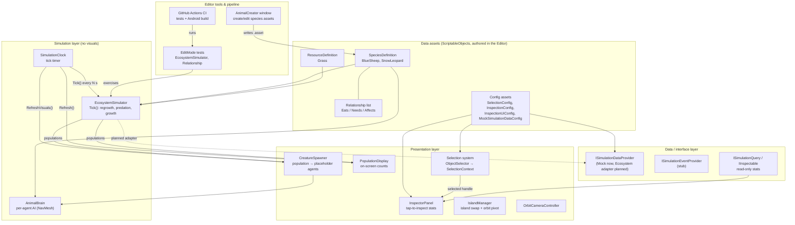

# EcoBalance — System Architecture (v0.1)

**Owner of this document:** Tan Wei Leong (Tech Lead)
**Status:** v0.1 for Milestone 1. It describes what is built and what is planned. Anything planned is marked *(planned)*.

See also: [toolchain.md](toolchain.md) (technology choices), [data-pipeline.md](data-pipeline.md) (asset/data rules) and [deliverables.md](deliverables.md) (M1/M2/M3 targets).

## 1. Tech stack (summary)

| | |
|---|---|
| Engine | Unity **6000.6.0f1** (Unity 6), URP |
| Language | C# |
| Target platform | Mobile (Android first) |
| Source control / CI | GitHub + GitHub Actions (GameCI): EditMode tests + Android build on every PR to `main` |
| Project management | Jira (SCRUM project) |

## 2. Architecture diagram

**How the parts communicate**
- **Tick loop:** `SimulationClock.Update()` calls `EcosystemSimulator.Tick()`, then `PopulationDisplay.Refresh()` and `CreatureSpawner.RefreshVisuals()`. It is a direct call chain with no events yet.
- **Data in:** the simulator and AI read `SpeciesDefinition` / `ResourceDefinition` assets. Prey comes from `SpeciesDefinition.GetSpeciesTargets(RelationshipType.Eats)`.
- **Data out:** population counts live in `EcosystemSimulator.populations` (a dictionary keyed by species asset). The UI reads them directly for M1. From M2 the UI reads through `ISimulationDataProvider`, so it never depends on simulation internals.
- **Selection → inspection:** `ObjectSelector` publishes the selected object on the shared `SelectionContext` asset, and `InspectorPanel` listens to it and shows `IInspectable` stats.

## 3. Components and owners

Owners follow the M1 Technical Deliverable plan. *Primary* owners are listed first.

| Component | Key scripts / assets | Deliverable | Owner(s) | M1 status |
|---|---|---|---|---|
| Ecosystem Simulation Core | `EcosystemSimulator`, `SimulationClock` | T03 | Wei Leong, Reginald | Predator–prey tick loop working and tested. Grazing and time controls in progress. |
| Relationship System | `Relationship`, `SpeciesDefinition.relationships` | T01 | Zhi Jie | Done (Eats / Needs / Affects), with tests |
| Entity Data System | `SpeciesDefinition`, `ResourceDefinition`, species assets | T02 | Li Juan, Yusuf | Data model working. Species data being expanded. |
| Species authoring tool | `Editor/AnimalCreator` | T02 | Li Juan | Create + edit species from an Editor window |
| Simulation Data Display (UI) | `PopulationDisplay`, `SimulationData/*` providers | T04 | Yan De, Dillon | Species counts on screen. Resource display + provider adapter in progress. |
| Agent AI Controller | `AnimalBrain` (NavMesh) | T07 | Zhi Jie, Reginald (Yusuf: AI structure) | Wander working. Seek/flee in progress. |
| Visualisation (population → agents) | `CreatureSpawner`, placeholder prefabs | T03/T04 | Wei Leong | Placeholder agents spawn by population |
| Selection & Inspection | `Selection/*`, `Inspection/*`, `InspectorPanel` | F09 | Yan De | Tap-to-select + inspector panel framework |
| Audio | `Audio/AudioManager` | — | Li Juan | Setup in progress |
| Metrics & Data Logging | *(planned)* | T05 (optional) | Unassigned | Not started |
| Weather & Hazard Events | *(planned)* | T06 (optional) | Unassigned | Not started |
| CI / build / test pipeline | `.github/workflows/unity-ci.yml`, `Tests/Editor/*` | #4, #5 | Wei Leong | Done: tests + Android build green on `main` |
| UI/UX design | Figma / `docs/design/ui-ux` | — | Nomitha, Shu Min (Design) | Wireframes / mockups |

## 4. Data stores

| Store | What | Where |
|---|---|---|
| ScriptableObject assets | Species, resources, relationships, system configs | `Assets/_Project/ScriptableObjects/`, `Assets/_Project/Data/` |
| Runtime state | Populations and resource amounts (in memory, per play session) | `EcosystemSimulator.populations`, `ResourceDefinition.currentAmount` |
| Scenes / prefabs | Level layout and agent prefabs | `Assets/Scenes/`, `Assets/_Project/Prefabs/` |
| Exported metrics *(planned, T05)* | Per-tick population history as CSV | — |

There is no server or database. EcoBalance is a single offline mobile app.

## 5. External systems

| System | Used for |
|---|---|
| GitHub + GitHub Actions (GameCI Docker images) | Source control, PRs, automated tests and Android builds |
| Unity Licensing (serial activation in CI) | Activating the Unity editor on CI runners |
| Jira | Backlog, epics per feature/deliverable, individual task tracking |

## 6. Layers (detail)

### Simulation layer (core logic, no visuals)
- **Entity Data System:** species/resource properties are configurable ScriptableObject data, not hardcoded.
- **Relationship System:** defines what each entity eats/needs/affects, configurable per entity.
- **Individual Agent System** *(planned)*: per-organism live state (hunger, thirst, health) for tap-to-inspect.
- **Animal AI / Behaviour System:** per-agent decisions (seek food, flee, hunt) driven by agent state.
- **Plants/Resources System:** resource consumption, depletion and regeneration over time.
- **Ecosystem Simulation Core:** a tick-based engine connecting all of the above over time.

### Data / interface layer
- **Simulation Data Tracking** *(planned)*: records population/resource history each tick and feeds the UI graphs/timeline.
- **Simulation Data Provider:** a read-only `ISimulationDataProvider` (string species/resource ids) for Displays 1–2, with a mock for UI-first work.
- **Simulation Event Provider:** an `ISimulationEventProvider` stub for the Display 3 behaviour feed.
- **Contextual Trigger System** *(planned)*: detects meaningful simulation changes and fires events for the UI.
- **Simulation Time Control:** play/pause/speed/reset *(in progress, T03)*.

### Presentation layer
- **Visualisation/Feedback:** translates simulation and AI state into visible feedback (population → agents, AI state → animation, vegetation depletion).
- **UI** (Design-owned): inspector panel, population graphs/timeline, contextual learning prompts.
- **Selection System:** generic click/tap picking (`ObjectSelector` + `ISelectable`), published on a shared `SelectionContext` asset.
- **Selection Highlight:** `SelectionHighlighter` + `ISelectionHighlightVisual` (ground ring) driven by `SelectionHighlightConfig`.
- **Inspection Data Interface:** read-only `IInspectable` / `StatEntry` via `ISimulationQuery` and an `InspectionConfig` schema catalog.
- **Inspector Panel:** type-agnostic `InspectorPanel` + `StatRowView`, styled by `InspectionUiConfig`.
- **Overlay Positioning:** `IOverlayPositioner` (Screen Space + World Space) driven by `InspectionUiConfig.overlayMode`.
- **Island Platform:** `IslandManager` owns the active island instance (spawn at `worldAnchor`, `centerOffset` pivot fix, swap with fade + ecosystem reset). Per-island data lives on `IslandDefinition` assets; platform knobs on `IslandPlatformConfig`. Implements `IOrbitTarget` for the camera.
- **Orbit Camera:** `OrbitCameraController` + `CameraConfig` (InputActionReferences, clamps, damping); pivots via `IOrbitTarget` only. See [camera.md](camera.md).

## 7. Design principles

- **Data-driven:** new organisms, resources or relationships are added as data assets, without new simulation code. This has been validated conceptually on two domains (Himalayan blue sheep/snow leopard, and a tree/paper resource cycle).
- **Layered, one-way dependencies:** the simulation never references UI. The UI reads simulation state (through interfaces from M2).
- **Testable core:** the simulation logic runs in EditMode tests without a scene, and CI runs those tests on every PR.

---
*Diagram and component/owner tables drafted with AI assistance: Claude Code (Claude Opus 5.5, claude-opus-5-5). Reviewed by Tan Wei Leong. Layer descriptions in §6 written by the team.*
